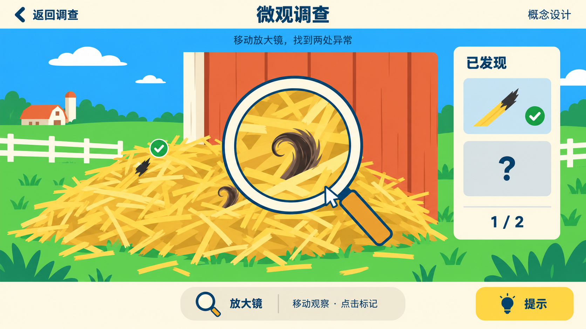
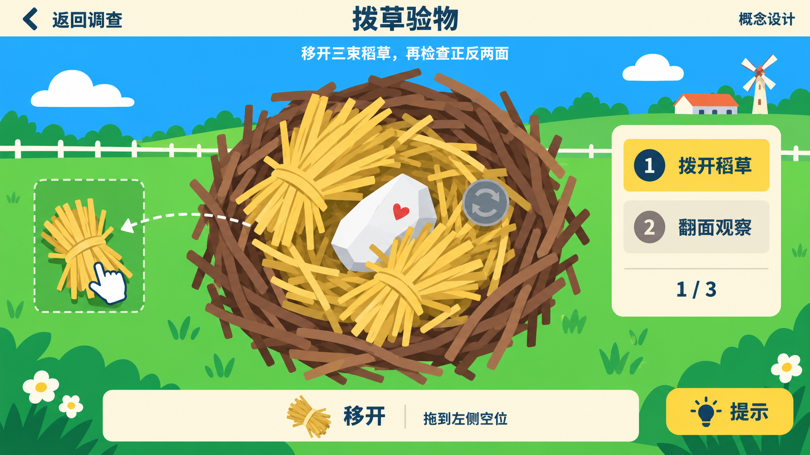
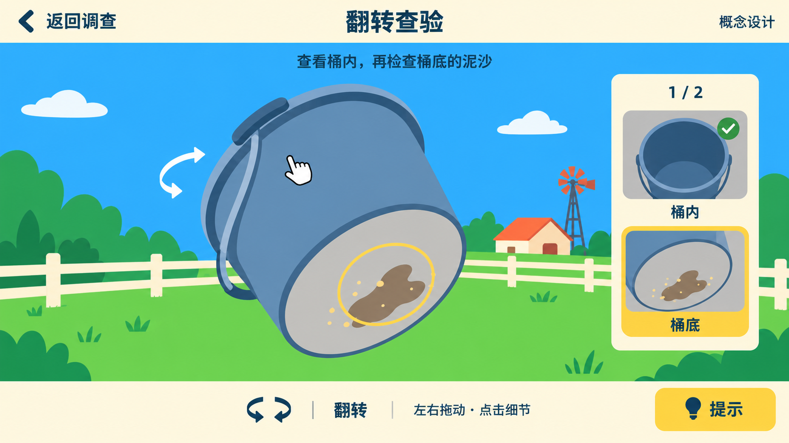
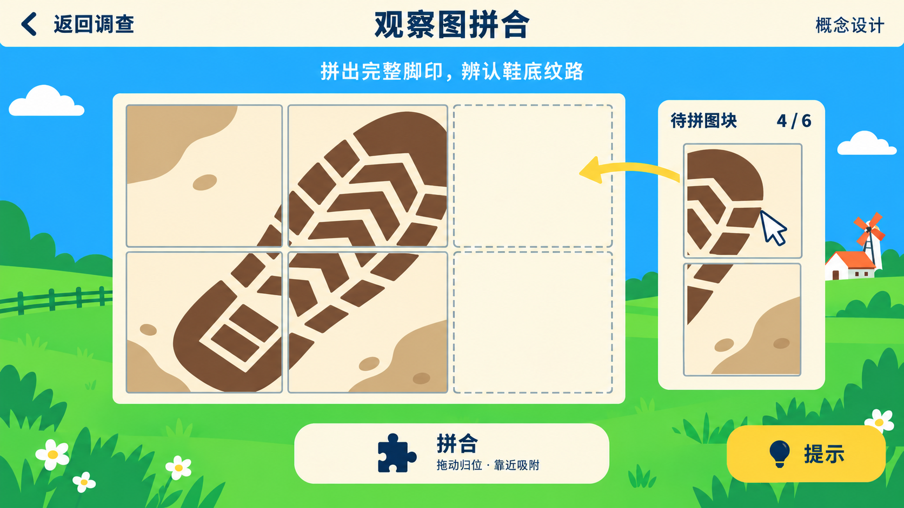
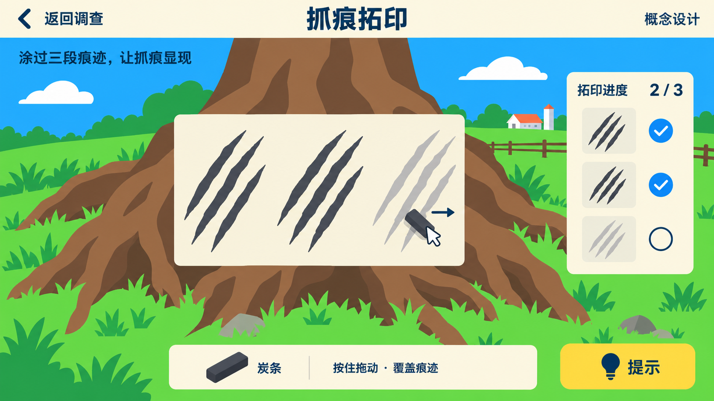
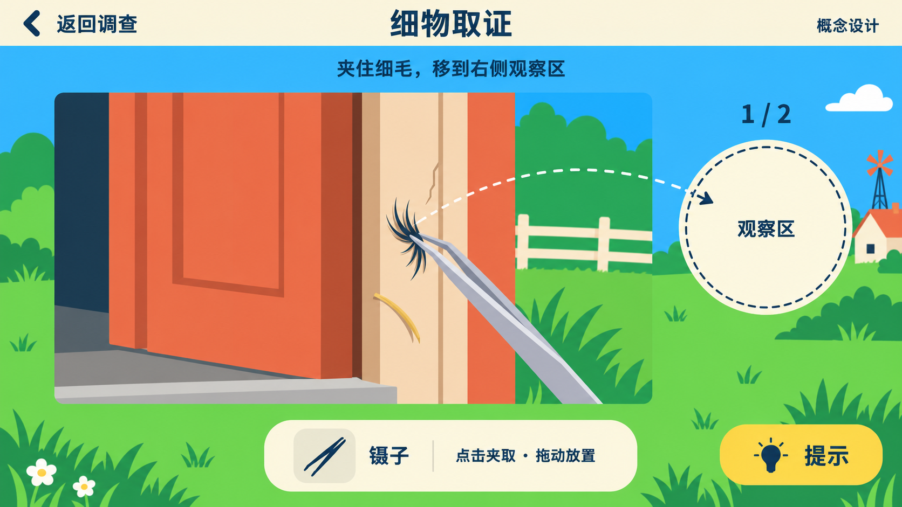
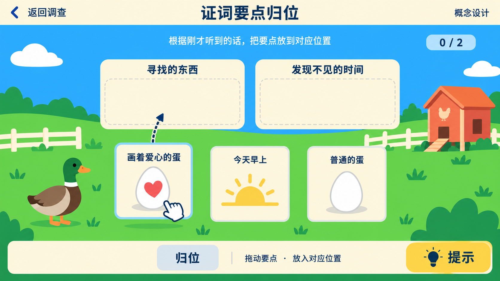

# 19 关键线索调查解谜

> **状态：设计规格，供评审与后续程序接入。** 本文定义关键线索获得前的独立 2D 调查界面、19 局具体题目、成功提交时机和美术构图。剧情顺序与原有分支以 [07-关卡与内容结构](./07-关卡与内容结构.md) 为准；线索原文见 [09-侦探笔记本](./09-侦探笔记本.md)、[13-玩家线索与交互点总表](./13-玩家线索与交互点总表.md)；原有状态名见 [17-全局游戏状态变量](./17-全局游戏状态变量.md)。

## 19.1 体验与范围

玩家在农场点击关键调查点，或听完关键证词后，进入单独的全屏 2D 界面。玩家通过放大、拨开、翻转、拼合、拓印、镊取或要点归位，确认当前现场看得到的细节、整理刚刚听到的原话。完成本局后，线索才写入笔记本，原有剧情继续。

**笔记本承担线索记录与回看。** 本次调查界面使用独立背景、独立操作区和工具栏。笔记本中的条目、连线、划线和翻页仍按原事件自动更新；终局手帐漫画沿用原演出。

本方案共 **19 局**：13 局关键物证调查，6 局关键证词整理。同一段对白同时产生的关联条目合为一局，例如 D04／D05／D06、E04／D07。七种交互是可复用模板，各局具有自己的物件、目标与判定。

主线继续使用原有替代路径：

- E01／E02／E03 任意两条开启普通小鸡水怪质询；第三条供自主调查。
- E14／E15／E16／E28 任意两条，加上正门碰壁 E13，开启摇树；另外两条供自主调查。
- 先推进黑猫案情线的玩家，通过小鸡 2-G 合并补漏获得 D03 与 D09。
- 薄荷鱼保留自主发现和老鼠指引两条路径。

**19 局是全部内容清单，不是新增的“全清才能通关”要求。** 各局入口使用原线索的时机与条件。E28 可以在第一章自由探索时完成；其余调查也保留原流程允许的自由先后。

E06 小围墙、E13 紧闭大门、E20 二层窗等空间闸沿用原交互；辅助线索、氛围点、奶酪拾取、付费情报与 D08／D12／D14／D18 等任务提示沿用原反馈。悲伤蛙三轮对暗号、老鼠售后与奶酪经济沿用原规则。本次各局使用界面提供的工具，无工具背包、工具购买或额外奶酪奖励。

### 19.1.1 剧情步骤与调查局速查

| 剧情步骤 | 调查局 | 获得的关键线索 | 本局操作 |
| --- | --- | --- | --- |
| 一-1 淑芬委托 | Q01 | D01 爱心蛋失踪 | 两个要点归位，排除普通蛋卡 |
| 一-2 鸡舍周边 | Q02 | E01 短木炭 | 翻看磨平炭尖与草叶炭粉 |
| 一-2 鸡舍周边 | Q03 | E02 黄色绒毛 | 镊取三根绒毛，排除黄草 |
| 一-2 小鸡身后 | Q04 | D02／E03 偷听 | 归类小鸡刚说过的三句话 |
| 一-3 质问小鸡 | Q05 | D03 水怪说 | 归位外形、来处与求证对象 |
| 一-4 池塘；二-5 可补录 | Q06 | E12 蛙身下绿垫 | 放大观察露边与垫高轮廓 |
| 一-4 询问悲伤蛙 | Q07 | D04–D06 三句证词 | 按原话顺序归位三张卡 |
| 一-5～一-6 初见大黄 | Q08 | D07 目击＋E04 狗压木梯 | 归位叼走者、去向、追赶结果 |
| 一-7 鸡舍水槽边 | Q09 | E05 谷物泡水取得 | 放大确认胀谷粒与浑浊液体 |
| 一-9 谷仓平台途中 | Q10 | E07 午睡草窝 | 拨浮草，确认压痕与细毛 |
| 一-9 谷仓平台途中 | Q11 | E08 烧焦稻草／皮毛 | 放大标记焦尖与卷毛 |
| 一-10 屋顶对峙后 | Q12 | E10 白石头 | 拨开三束草，翻面查爱心和鬼脸 |
| 一-11；二-6 可合并补漏 | Q13 | D09 招供；补漏同时发 D03 | 分清假石事件与昨晚真蛋失踪 |
| 二-2 红顶屋外 | Q14 | E14 猫门 | 放大确认小锁扣与磨亮边缘 |
| 二-2 红顶屋外 | Q15 | E15 食碗 | 翻看碗沿爪印与碗底食渣 |
| 二-2 红顶屋外 | Q16 | E16 兽毛 | 夹取一撮细毛并放入观察区 |
| 一章自由探索；二-2 可补查 | Q17 | E28 树根抓痕 | 涂显三段抓痕揭露区 |
| 二-2；二-6 可补查 | Q18 | E17 空水桶 | 翻转确认桶内为空与桶底泥沙 |
| 二-2；二-6 可补查 | Q19 | E18 雨靴脚印 | 六块观察图拼合，再确认鸡舍方向 |

Q02／Q03／Q04 保持任意两条，Q14／Q15／Q16／Q17 保持任意两条；每个调查局的条件、答案与成功出口见下文。完整示例路线见 [20-典型玩家完整游玩流程](./20-典型玩家完整游玩流程.md)。

## 19.2 独立调查 UI

### 19.2.1 1920 × 1080 参考布局

以 16:9 的 1920 × 1080 画布为美术与排版基准，按安全区等比适配：

- **顶部 y=0–96**：左侧“返回调查”，中央本局标题，右侧“操作帮助”。返回按钮须一直可见；概念图中的“概念设计”仅为评审角标，不作为正式界面按钮。
- **目标句 y=96–168**：一句明确操作目标，例如“移动放大镜，找到两处异常”。
- **主操作区 x=115–1400，y=216–853**：完整展示对象及拖动余量。物证占据主要面积，周围保留能帮助定位的现场色块。
- **右侧发现进度 x=1498–1805，y=238–756**：目标数量、已确认局部与本局反馈。未发现目标以空槽或轮廓显示；发现后才出现名称。
- **底部工具区 y=950–1058**：本局工具、复位和对应操作说明。按钮与拖动轨迹保持距离。
- **右下提示**：独立的两级提示按钮。证词局还提供“重听这一段”，调用刚刚播放的原对白。

操作目标必须完整处于主操作区内，工具栏与右侧进度栏均不可遮住目标。1920 × 1080 基准下，点击热区至少 **64 × 64 px**，拖入区至少 **96 × 96 px**；小毛、草尖等可见图形可以更小，但使用较大的透明热区。

主操作区使用晴天蓝、鲜绿草地、奶油白和局部场景色；界面边框、卡槽与按钮使用简单几何形。拓印使用贴在树皮上的单张取样薄纸作为工具，观察图拼合使用清晰的矩形图块。两者均属于当前调查对象的操作材料。

### 19.2.2 通用反馈与容错

- **时长目标**：每局首次操作约 5–40 秒。放大镜与翻转局约 10–25 秒；拼合、拓印和证词局约 20–40 秒。
- **开始**：展示题面、目标数量和一次简短手势示意；玩家主动点击或拖动后示意消失。
- **过程**：正确目标用深蓝描边和小勾标记，同时播放轻声反馈；已经确认的目标继续留在原处。
- **错误**：对象轻弹回原处或显示“再观察一下”。没有生命、倒计时、次数限制和资源扣减。
- **提示一级**：指出观察方向或复述要点；**提示二级**：高亮当前目标或正确目标槽。玩家仍完成最后一次点击、拖动或拓印。
- **退出**：立即返回本局来源场景，保留本局进度；再次点击同一入口继续。退出时线索、计数与剧情状态保持在本局成功提交前的值。
- **复位**：只复位当前画面中的未确认操作；已确认目标与已成功局的记录保留。
- **成功**：先展示已确认物证／原话的完成反馈，再一次性提交原有线索与状态，返回原对白出口或原环境位置。

各局下文的“错误／退出”补充本局操作细节，并共同遵循以上规则。成功过的同一线索再次查看时展示完成态，不重复计数，也不再次强制解谜。

## 19.3 接入与提交边界

### 19.3.1 环境物证

原环境交互满足条件 → 保存本局入口与现场状态 → 打开独立调查界面 → 成功 → 播原有线索描述／大图反馈 → 统一写入原 E 变量、笔记条目与计数 → 返回原环境交互出口。

在本局成功提交前，其他 NPC 不能读取到该线索的已获得状态。例如观察到 E08 的一处草尖时，`E08_ViewBurnMark` 仍保持原值；完成焦尖与卷毛两个目标后才提交。

### 19.3.2 关键证词

原节点照常播放完整对白 → 在节点末写入与出口执行前保存待完成记录 → 打开证词整理局 → 成功 → 一次性提交该节点原有变量与笔记条目 → 执行原节点出口。

“刚听完但尚待整理”存入**本局存档记录**，包含题目 ID、来源 NPC／环境点、原节点、原出口、已确认目标及卡片位置。它不作为跨 NPC 的新全局布尔条件。退出后再次点击该来源，在原入口条件允许期间优先恢复这条待完成记录。玩家可重听已经听过的该段对白。

**E03 可选偷听的过时处理**：恢复 Q04 前先检查 `ChickStatus`；若其间已 `ChickStatus>=3`，则作废尚未结算的偷听记录，保持原交互关闭，不发 D02、不写 `E03_Overheard`、不增加计数。此项可选内容不会阻挡主线。若同一线索已由原有另一条分支合法补录，则清理对应待完成记录并显示完成态，继续使用原计数去重规则。

特别提交规则：

- **Q08 大黄初见**：E04、D07 与 `DogStatus=2` 同批提交。半睡 hub、E05 取泡水与相关话题在提交后开放。
- **Q13 小鸡 2-G 补漏**：一局整理合并证词；成功同批提交 `ChickStatus=3`、D03 与 D09，并按原规则划掉 D03。
- **Q06 E12 补录**：老鼠付费路线仍可通过 `Mouse_MintFishPaid` 进入悲伤蛙 3-A。该节点开场需要补录 E12 时先进入同一 Q06，完成后返回 3-A 第一轮。

### 19.3.3 计数、线索与剧情分工

`ChickTraceCount` 由 E01／E02／E03 各首次成功增加 1；`TreeClueCount` 由 E14／E15／E16／E28 各首次成功增加 1，E13 单独保留正门条件。重复点击、提示、复位、退出和读档均不重复增加。

E17／E18 的调查成功只发对应物证。玩家仍须在黑猫案情汇报菜单里分别汇报两件物证；`BlackCat_CaseLineBucketSaid`、`BlackCat_CaseLineBootSaid` 与最终 `BlackCat_CaseLineDone` 继续由原对白写入。

本局成功不会代替原对话中的借梯、架梯、叫醒大黄、嗅觉追踪、摇树、取薄荷鱼或交还薄荷鱼等后续动作。

## 19.4 第一章具体题目

### Q01 · D01：把委托听清楚

- **发生步骤／入口**：一-1，首次点击淑芬，完整播放淑芬 **1-A** 后、写 `Shufen_CommissionDone` 前。
- **模板／题面**：证词要点归位。“把要找的东西和发现不见的时间放到对应位置。”
- **初始物件／目标／干扰**：左侧芦笛绿头鸭与鸡舍的简洁插画，右侧 2 个大槽“寻找的东西”“发现不见的时间”；底部打乱 3 张要点卡：“画着爱心的蛋”“今天早上”“普通的蛋”。“普通的蛋”为干扰卡，留在待选区；周围的鸡舍图形属于背景。
- **操作**：从 3 张卡中选择对应的 2 张拖入槽，吸附后保留文字。可点扬声器重听淑芬 1-A。
- **正确答案／成功阈值**：“寻找的东西”→“画着爱心的蛋”，“发现不见的时间”→“今天早上”；2／2 正确，干扰卡留在待选区。
- **提示一级／二级**：一级：“淑芬说的蛋有特别标记，时间要找她发现窝空的那一刻。”二级：高亮“今天早上”与“发现不见的时间”槽。
- **错误／退出**：错槽卡片弹回待选区；退出后再次点淑芬恢复本局，已听过的委托可以重听。
- **成功提交／原出口**：D01 按原全文入册，保留“昨晚之前还动过一下”等委托信息；该信息不作为本局第三目标。`Shufen_CommissionDone=true`；回淑芬 **1-hub【回访】+【菜单】**，沿用首次委托出口。

### Q02 · E01：翻看短木炭

- **发生步骤／入口**：一-2，自由调查鸡舍草地上的短木炭；与 E02、E03 的先后自由。
- **模板／题面**：翻转查验。“看看炭尖和它旁边的草叶。”
- **初始物件／目标／干扰**：中央一截短木炭侧放在亮绿草叶上；炭尖初始朝右，背侧一片草叶遮住少量炭粉。目标为“磨平的炭尖”“蹭在草叶上的炭粉”两处。另有两片完整绿叶和一颗普通小石子作为无判定背景。
- **操作**：水平拖动木炭在两个观察角度间转动，转至炭尖正面后点击磨平端；切到背侧角度后点击草叶上的黑色粉痕。
- **正确答案／成功阈值**：两个观察角度分别确认上述目标，2／2 完成。木炭其他端面与小石子均不计目标。
- **提示一级／二级**：一级：“一处在木炭自己身上，一处留在它碰过的草上。”二级：先出现转动箭头，再轮廓高亮尚缺的一处。
- **错误／退出**：点击普通草叶只给轻反馈；拖动松手停留在最近观察角度。退出保留已确认处，原地重开继续。
- **成功提交／原出口**：`E01_ViewCharcoal=true`，首次 `ChickTraceCount+1`，E01 入册；返回鸡舍 E01 位置的原交互结束点。

### Q03 · E02：从草间夹出黄绒毛

- **发生步骤／入口**：一-2，点击鸡舍附近黄色羽毛碎屑；与 E01、E03 的先后自由。
- **模板／题面**：镊取物证。“夹出三根蓬松的黄色绒毛，放到观察盘。”
- **初始物件／目标／干扰**：主区草丛中固定摆放 3 根弧形黄绒毛，位置在左下、中央、右上；旁边各有普通黄草叶、奶油白小石和棕色草茎。右侧观察盘提供 3 个宽松落点。
- **操作**：选中镊子，点击夹住一根目标，拖至观察盘后松开。被夹起的图形放大，便于辨认轮廓。
- **正确答案／成功阈值**：3 根黄色绒毛全部放入观察盘；三处落点任意，毛尖方向自由。
- **提示一级／二级**：一级：“找弯弯的、边缘蓬松的黄色小毛，草叶边缘更平直。”二级：按顺序轮廓高亮一根尚未收取的黄绒毛与观察盘。
- **错误／退出**：夹到黄草叶时原位轻晃；拖到盘外自动放回来源处。退出保留已入盘数量，重开继续。
- **成功提交／原出口**：`E02_ViewFeather=true`，首次 `ChickTraceCount+1`，E02 入册；返回 E02 原环境交互结束点。观察盘为本局展示，不生成背包物品。

### Q04 · D02／E03：听见小鸡在说什么

- **发生步骤／入口**：一-2，玩家到小鸡圈子背后的 E03 范围主动点交互键，播放小鸡 **1-A** 偷听段后进入。
- **模板／题面**：证词要点归位。“把刚才偷听到的三句话分清。”
- **初始物件／目标／干扰**：左侧四只背对玩家的小鸡局部；右侧 3 个槽“他们猜测的响动”“他们提到青蛙说过的事”“他们准备对外说的话”；底部 3 张卡：“昨晚外面那声音……肯定是水怪干的”“宝珠沉下去了”“就说……水怪。从池塘来的。把蛋叼走了……”。卡片保持猜测与转述语气；鸡舍与草地只作背景。
- **操作**：拖卡归位，可逐句重听原偷听段。
- **正确答案／成功阈值**：3 张依次对应响动猜测／青蛙原话／统一口径，3／3 完成。题目只确认小鸡说了这些话。
- **提示一级／二级**：一级：“谁说过什么，和他们打算怎么说，是两件事。”二级：高亮含“就说”的卡与“准备对外说的话”槽。
- **错误／退出**：错卡弹回；退出后 `ChickStatus<3` 时可从 E03 恢复卡位。若其间已 `ChickStatus>=3`，作废尚未结算的可选偷听记录，沿用原关闭规则，不补发 D02、E03 状态或计数。
- **成功提交／原出口**：`E03_Overheard=true`，首次 `ChickTraceCount+1`，D02 入册；原小鸡 **1-A** 出口“对话结束”。提交后 E03 关闭；招供后 `ChickStatus>=3` 时沿用原关闭规则。

### Q05 · D03：整理小鸡的“水怪说”

- **发生步骤／入口**：一-3，普通小鸡 **2-B** 质询播毕。原菜单条件为 `ChickTraceCount>=2 && ChickStatus==1 && !BlackCat_CaseLineStarted`。
- **模板／题面**：证词要点归位。“记下小鸡的说法，以及他们让你向谁求证。”
- **初始物件／目标／干扰**：3 个槽“他们形容的外形”“他们说的来处”“下一位求证对象”；3 张卡：“三个脑袋！浑身绿色！”“从池塘爬上来！”“池塘那只青蛙”。画面用小鸡对白气泡和简洁图形表达传闻，水怪只作为小鸡说法的小涂鸦。
- **操作**：拖动 3 张卡对应归位；界面标题保留引号，强调这是待核实的证词。
- **正确答案／成功阈值**：外形→三个脑袋且绿色；来处→池塘；求证对象→青蛙，3／3 完成。
- **提示一级／二级**：一级：“两张描述水怪，一张告诉你该去问谁。”二级：高亮“池塘那只青蛙”卡与“下一位求证对象”。
- **错误／退出**：错卡返回，退出后再点小鸡优先恢复本局；普通 2-B 的末状态等成功后提交。
- **成功提交／原出口**：D03 入册，`ChickStatus=2`；返回小鸡 **2-hub【回访】+【菜单】**。黑猫案情补漏 2-G 使用 Q13 合并局，直接沿合并出口提交。

### Q06 · E12：观察蛙身下露出的绿边

- **发生步骤／入口**：一-4，玩家点蛙身下 E12；或二-5，老鼠付费指引路线进入悲伤蛙 **3-A**，开场需要补录 E12 时进入。
- **模板／题面**：放大镜调查。“看看绿边与荷叶接触的地方。”
- **初始物件／目标／干扰**：主区只见荷叶、蛙身体下缘和露出的一截绿垫边缘。两处目标为“与荷叶不同的绿色垫边”“垫在身下形成的一层隆起”。荷叶亮部和池水小圆波纹为背景；蛙身体保持原位，绿垫主体由蛙遮住。
- **操作**：移动放大镜到露边中段、露边与荷叶交接的侧缘，分别点击确认。第二处确认时衔接原有草本甜气描述。
- **正确答案／成功阈值**：露边材质色块与垫高轮廓两处均确认，2／2 完成。当前结论保持“有块气味奇异的绿垫”。
- **提示一级／二级**：一级：“沿着蛙身下多出来的那一层看。”二级：轮廓高亮两个露边目标中的未完成处。
- **错误／退出**：点池水波纹只提示继续观察；镜片可自由移动。环境入口退出回池塘；3-A 补录入口退出后保存同一待完成节点，再点蛙继续。
- **成功提交／原出口**：`E12_ViewGreenPad=true`，E12 入册；D12 已入册时按原规则自动补 D13 及连线。环境入口返回 E12 原结束点；3-A 补录入口回悲伤蛙 **3-A 第一轮对暗号**。

付费路线进入 3-A 的原条件继续使用 `(E12_ViewGreenPad || Mouse_MintFishPaid) && !Frog_PadRefused && !MintFish_Obtained`。本局不改变 `MintFish_Obtained`、`Frog_PadRefused`、`Mouse_MintFishPaid`；完整薄荷鱼由原取鱼演出揭示。

### Q07 · D04／D05／D06：把蛙的三句原话摆好

- **发生步骤／入口**：一-4，悲伤蛙 **2-D** 水怪质询播毕；原条件 `ChickStatus>=2 && !Frog_WaterMonsterQueried`。
- **模板／题面**：证词要点归位。“按刚才听到的顺序，摆好三段原话。”
- **初始物件／目标／干扰**：3 个槽“第一段”“第二段”“第三段”；3 张打乱的卡：“纯净，第一个死去。”“冰冷的器皿来了。生命之源在枯竭。”“一个黑色的恶魔……它带走了宝珠。”背景为晴天下的池塘与蛙侧影，卡片只写原隐语。
- **操作**：拖卡到序号槽，可点“重听三句话”；卡片文本始终完整可读。
- **正确答案／成功阈值**：按“纯净→器皿与生命之源→黑色恶魔与宝珠”排列，3／3 完成。答案不要求玩家解释这些隐喻指向谁。
- **提示一级／二级**：一级：“蛙先说失去的纯净，再说器皿，最后说黑色恶魔。”二级：当前尚未归位的第一张卡和目标序号同时高亮。
- **错误／退出**：错序卡返回待选区；退出后再点蛙优先续局，保留原证词重听入口。
- **成功提交／原出口**：D04、D05、D06 同批入册，`Frog_WaterMonsterQueried=true`；返回悲伤蛙 **2-hub【回访】+【菜单】**。原笔记连线按双方条目状态自动出现。

### Q08 · D07／E04：整理大黄的迷糊目击

- **发生步骤／入口**：一-5～一-6，谷仓旁首次点大黄，`DogStatus==1`，播放大黄 **1-A** 初见与半睡复述后进入。
- **模板／题面**：证词要点归位。“记下大黄说他看见了什么。”
- **初始物件／目标／干扰**：左侧大黄半压侧倒短木梯的现场插画；右侧 3 个槽“他说的叼走者”“他说的去向”“他自己的追赶结果”；底部 3 张原话卡：“乌鸦……叼走了”“往谷仓屋顶飞了”“只咬到一嘴空气”。短梯与鼾声符号作为已看到的现场信息。
- **操作**：将三张卡对应放好；可重听大黄完整 1-A。卡片明确归属于大黄的说法。
- **正确答案／成功阈值**：叼走者→乌鸦；去向→谷仓屋顶；追赶→咬到空气，3／3 完成。局内不推断目击的具体日期。
- **提示一级／二级**：一级：“分清谁飞走、飞到哪、留下的大黄做了什么。”二级：高亮“往谷仓屋顶飞了”与“他说的去向”。
- **错误／退出**：错卡弹回；退出仍处于 1-A 待整理状态，再点大黄恢复本局。原 1-A 中受 E06 控制的缺梯短段沿用原播放条件。
- **成功提交／原出口**：E04、D07 同批入册，`DogStatus=2`；不新增 E04 布尔变量。返回大黄 **1-A′【回访】+【菜单】**，此后方可取 E05、询问醒酒提示。

### Q09 · E05：辨认谷物泡水

- **发生步骤／入口**：一-7，在水槽边点击 E05，原条件 `DogStatus>=2`。D08 提示与 E06 小围墙调查均保持各自的自由获取顺序。
- **模板／题面**：放大镜调查。“看清水里漂着什么，以及液体的样子。”
- **初始物件／目标／干扰**：一桶浑浊浅黄液体，水面有 3 粒胀开的谷粒；目标为“浮着的胀谷粒”“浑浊液体”。桶外的绿叶、清水小水洼为背景，不能装入桶。
- **操作**：移动镜片到谷粒群点击一次，再移到无谷粒的液体中央点击一次。谷粒群共用一个宽松目标区。
- **正确答案／成功阈值**：两处确认，2／2 完成；原酸味描述随确认呈现。目标是辨认当前液体，无配方、兑水或调制步骤。
- **提示一级／二级**：一级：“先找水面的小颗粒，再看颗粒下面的水。”二级：高亮谷粒群或液体观察区中尚缺的一处。
- **错误／退出**：点击桶箍和外部水洼只给轻反馈；退出可原地续查，不会取得泡水。
- **成功提交／原出口**：`E05_GrainSoakGet=true`；按原规则在 D08 旁加 `✓ get`，若 D08 晚入册则直接显示当前完成态。返回 E05 原环境出口；玩家仍须回大黄 **1-A′** 选择“先喝点这个”进入 **1-B**，`DogStatus=3` 继续由 1-B 写入。

### Q10 · E07：拨开草窝边缘

- **发生步骤／入口**：一-9，已架短木梯进入谷仓平台路线，点击午睡点；E07 与路线其他观察点沿用原空间可达性。
- **模板／题面**：拨开遮挡。“拨开边缘的浮草，确认留下的压痕与细毛。”
- **初始物件／目标／干扰**：中央为已压出圆形低凹的干草窝，前缘覆盖 2 束松散浮草；凹陷边界与 2 根深色细毛被部分遮住。两侧完整草垛作为背景。
- **操作**：向外拖开两束可动浮草；分别点击完整显露的凹陷轮廓、边缘深色细毛。浮草只在本局画面移开。
- **正确答案／成功阈值**：两束草离开目标区，且压痕、细毛均确认，2／2 完成。当前结论保持“有人常在这里午睡”。
- **提示一级／二级**：一级：“从草窝前缘露出的两端向外拨。”二级：高亮尚未移开的草束与拖动方向，随后高亮未确认目标。
- **错误／退出**：拖整堆背景草无反应；拖动未越过目标区时松手弹回。退出保留已移草束与确认项。
- **成功提交／原出口**：`E07_ViewNapSpot=true`，E07 入册；返回 E07 原环境出口。原各 NPC 午睡点话题及黑猫薄荷鱼线依据随该变量开放，问过大黄的 `E07_NapSpotAsked` 仍由大黄 **1-F** 单独写入。

### Q11 · E08：用镜片找浅焦痕

- **发生步骤／入口**：一-9，谷仓平台途中点击 E08；原路线在 E07 后经过此处。
- **模板／题面**：放大镜调查。“找到焦黑的草尖和卷曲的毛尖。”
- **初始物件／目标／干扰**：主区是稻草与一小撮深色毛。左上 3 根草的顶端焦黑，中央偏右的深色毛尖卷曲；普通棕色完整草梗、自然弯折但颜色均匀的草叶为干扰。两目标相隔，便于移动镜片探索。
- **操作**：把放大镜移至焦黑草尖、卷曲毛尖；镜内放大以清晰色块表现差异，点击确认。
- **正确答案／成功阈值**：确认“草尖焦黑”“毛尖燎卷”两处，2／2 完成；同一组草尖重复点算同一目标。
- **提示一级／二级**：一级：“看末端的颜色，再看毛尖有没有卷起来。”二级：轮廓高亮尚缺目标的局部位置。
- **错误／退出**：普通草梗点后不打勾；镜片走出主区自动留在安全边界。退出重开延续确认状态。
- **成功提交／原出口**：`E08_ViewBurnMark=true`，E08 入册；返回 E08 原环境出口。乌鸦玻璃珠追问与黑猫薄荷鱼线依原条件开放；玻璃珠成因由原后续对白说明。

### Q12 · E10：从巢草里看清白石头

- **发生步骤／入口**：一-10，首次登顶先播乌鸦 **2-A** 对峙，玩家随后主动点巢中 E10，衔接 **2-B** 的白石调查段。
- **模板／题面**：拨开遮挡＋翻转查验，同一局。“拨开巢草，再看看这件东西的两面。”
- **初始物件／目标／干扰**：巢中央是一颗天然白圆石，3 束巢草局部盖住爱心面与外轮廓；左侧预留草束停放区，背面鬼脸初始不可见。外围玻璃珠、瓶盖等是巢中背景，玻璃珠本身沿用 E34 独立调查。
- **操作**：将 3 束巢草全部向左拖入停放区；清理阶段完成后，进度切至双面查验。点击爱心，再拖动白石翻到背面，点击鬼脸。石头翻转时维持实心圆石轮廓。
- **正确答案／成功阈值**：清理阶段 3／3 草束到位后，双面查验从 0／2 开始；爱心面与鬼脸面均确认，2／2 时本局成功。完成反馈使用原“这是一块白石头”的结论。
- **提示一级／二级**：一级：“先露出表面，再用下方的翻转箭头看另一面。”二级：高亮剩余草束；草束全移开后，高亮翻转把手和未确认图案。
- **错误／退出**：巢中背景物点击只给轻反馈；未完成翻转可随时重试。退出回屋顶，E10 保留继续入口；首次登顶对峙按原状态保持一次性。
- **成功提交／原出口**：`E10_ViewWhiteStone=true`，E10 白石双面插图写入第二页并触发翻页；D07 依原规则划掉并旁注“只是一块石头”。接回乌鸦 **2-B** 的剩余对白，随后 **2-hub【回访】+【菜单】**。小鸡 2-E、大黄 1-G、淑芬 2-A 的原选项此时开放。

### Q13 · D09：分清假石事件与真蛋失踪

- **发生步骤／入口 A**：一-11，持 E10 回访小鸡，原 **2-E** 招供播毕；条件 `E10_ViewWhiteStone && ChickStatus<3 && !BlackCat_CaseLineStarted`。
- **发生步骤／入口 B**：二-6 补调查，黑猫案情线已开、小鸡仍 `ChickStatus<=1`，原入口强制进入 **2-G** 合并补漏全招，播毕进入本局。
- **模板／题面**：证词要点归位。“把这两次事件分清，记下小鸡说弟弟何时失踪。”
- **初始物件／目标／干扰**：两个宽槽“白石假蛋那次”“昨晚真蛋失踪”；底部 3 张原话要点卡：“白石画成假蛋，真蛋带出去又推回窝”“假石扔进草丛，后来被乌鸦叼走”“弟弟是昨晚才不见的！跟那一趟不是一回事！”。前两卡属于同一组，第二槽收第三卡。卡片只使用本段已听到的事实；日期不做可拖动答案。
- **操作**：拖 3 张卡到事件组。每个槽允许多张卡，正确落入后按叙述顺序自动排齐。
- **正确答案／成功阈值**：前两张归“白石假蛋那次”，第三张归“昨晚真蛋失踪”，3／3 完成。玩家只区分两次事件，不必回答乌鸦叼石的绝对日期。
- **提示一级／二级**：一级：“真蛋被推回窝，和昨晚真蛋失踪，是两次不同的事。”二级：高亮“弟弟是昨晚才不见的！跟那一趟不是一回事！”与“昨晚真蛋失踪”槽。
- **错误／退出**：错卡返回；退出后再次点小鸡优先恢复原 2-E 或 2-G 的待完成记录。2-G 不要求先完成 Q05、补齐 E01／E02／E03，也不连续插入第二局水怪整理。
- **成功提交／原出口 A**：`ChickStatus=3`，D09 入册；D03 已在册时按原规则划掉并旁注“老鼠兄弟捉弄小鸡的谣言”。返回小鸡 **2-hub【回访】+【菜单】**。
- **成功提交／原出口 B**：同批写 `ChickStatus=3`、补录 D03 与 D09，D03 当次直接显示划掉和旁注；接原 **2-G→2-hub【回访】+【菜单】**。蛙水怪质询继续读 `ChickStatus>=2`。

> ⚠️ **待议：既有招供日期口径。** 小鸡树状 2-E 中“乌鸦叼走的是……假石头——大前天的事”与 05／10 的“乌鸦在 T-2 清晨叼假石”存在日期冲突。本文以“假石事件／昨晚真蛋失踪”作为题目分组；乌鸦绝对日期留待叙事文档统一后再纳入可考信息。

## 19.5 第二章具体题目

二-1 仍由大黄确认蛋味、玩家调查 E13 正门碰壁。二-2 的下树线索保持任意两项选择，案情物证保持 E17、E18 两项都需调查；下列局号代表内容编号，不规定玩家必须按局号游玩。

### Q14 · E14：放大猫门的使用痕迹

- **发生步骤／入口**：二-2，点击红顶屋小猫门。
- **模板／题面**：放大镜调查。“看看小门的细小锁扣和磨亮边缘。”
- **初始物件／目标／干扰**：正面猫门占主区，目标为右上小锁扣、下沿磨得发亮的一段边缘；门板普通铆钉和屋门装饰为干扰。门的形状清楚，操作目标相隔至少一枚镜片宽度。
- **操作**：镜片移到锁扣、亮边，分别点确认；镜内展示简化放大图。
- **正确答案／成功阈值**：两个细节确认，2／2 完成。锁扣作为观察对象保持原位。
- **提示一级／二级**：一级：“一个细节能扣住门，另一个细节被反复进出磨亮。”二级：轮廓高亮尚缺的锁扣或亮边。
- **错误／退出**：点击铆钉不给确认；拖锁扣只出现观察反馈。退出保留已确认局部，原地重开继续。
- **成功提交／原出口**：`E14_ViewCatDoor=true`，首次 `TreeClueCount+1`，E14 入册；返回 E14 原环境出口。猫门通路仍由黑猫原后续剧情使用。

### Q15 · E15：翻看陶瓷食碗

- **发生步骤／入口**：二-2，点击红顶屋门外陶瓷碗。
- **模板／题面**：翻转查验。“看看碗沿图案和碗底剩下的东西。”
- **初始物件／目标／干扰**：中央奶油白陶瓷碗，初始略倾斜，外沿小爪印可见、内底余渣被前沿部分遮住；普通装饰色条为无判定元素。
- **操作**：先点碗沿小爪印；上下拖动将碗倾成俯视角，再点内底的一小撮细碎食渣。
- **正确答案／成功阈值**：确认爪印花纹、碗底余渣两处，2／2 完成；余渣由简洁小色块表现。
- **提示一级／二级**：一级：“沿着碗口看一圈，再朝碗里看。”二级：显示向上倾斜箭头，并高亮尚缺目标。
- **错误／退出**：点击装饰条轻反馈；角度拖过范围时停在边界。退出保存观察角度与确认项，返回场景的碗仍处在原位。
- **成功提交／原出口**：`E15_ViewFoodBowl=true`，首次 `TreeClueCount+1`，E15 入册；返回 E15 原环境出口。

### Q16 · E16：镊取门边细软兽毛

- **发生步骤／入口**：二-2，点击门边深色兽毛；摇树前后均沿用原可调查性。
- **模板／题面**：镊取物证。“夹起这一撮细软兽毛，放进观察区。”
- **初始物件／目标／干扰**：门脚边 1 撮深蓝黑色细软兽毛，整撮作为一个可夹取对象；旁有 1 根棕色硬草梗、1 片深绿叶和一条门板缝线。右侧观察区有 1 个宽松落点，进度分“夹起物证”“放入观察区”两步。
- **操作**：镊子点击夹住整撮兽毛，进度到 1／2；将它拖至观察区松开，进度到 2／2。夹起时物证放大，背景保持原位。
- **正确答案／成功阈值**：同一撮兽毛完成夹取与放置两步，2／2 完成；不要求玩家先认定是哪种动物。
- **提示一级／二级**：一级：“找那撮细软的深色毛，夹起后移到右边空出的区域。”二级：夹取前高亮整撮兽毛，夹起后高亮观察区。
- **错误／退出**：草梗、叶片和门缝无法夹起；区外松手返回原处，夹取进度回到 0／2。退出后恢复同一阶段；已夹起时显示镊子持物，玩家继续拖入观察区。
- **成功提交／原出口**：`E16_ViewFur=true`，首次 `TreeClueCount+1`，E16 入册；返回 E16 原环境出口。原反馈按 `E30_BlackFurSeen` 与黑猫是否下树切换：见过巢中黑毛且黑猫未下树时自问“乌鸦真的长毛吗”；黑猫已下树时可说“黑猫的毛”。

### Q17 · E28：拓出树根上的抓痕

- **发生步骤／入口**：一章自由探索可点击大橡树根；二-2 可补查。入口沿用 E28 原可达性，计数可提前累积。
- **模板／题面**：痕迹拓印。“沿着取样纸轻轻涂出三段抓痕。”
- **初始物件／目标／干扰**：主区为树根局部，上面贴一张小幅奶油白取样薄纸，纸下分 3 段抓痕揭露区，每段可包含数条细长痕迹，右侧提供对应的三组进度；旁边粗大树皮分界仅作背景。底部提供本局炭条与复位工具。
- **操作**：按住炭条拖过取样纸；实际经过的区域逐步显出深蓝色拓痕。目标区域有宽松的采样范围，炭条无消耗。
- **正确答案／成功阈值**：3 段揭露区各自至少 **80%** 的目标采样范围被涂过；右侧三组进度分别完成后打勾，3／3 完成。普通树皮分界不纳入采样目标。
- **提示一级／二级**：一级：“用长一点的笔触，依次涂过三段痕迹区域。”二级：纸面用虚线标出尚未达到 80% 的揭露区；玩家继续涂到阈值即可。
- **错误／退出**：纸外拖动不落色；背景涂画不扣分，目标按各自覆盖计算。退出保留拓痕覆盖，原地重开继续。本局炭条由 UI 提供，不要求先拿 E01。
- **成功提交／原出口**：`E28_ViewTreeScratch=true`，首次 `TreeClueCount+1`，E28 入册；返回 E28 原环境出口。摇树仍须第二章大黄原条件、E13 与任意两条下树线索。

### Q18 · E17：翻转倒扣空桶

- **发生步骤／入口**：二-2 先行调查，或二-6 黑猫案情汇报提示后补查，点击门旁 E17。
- **模板／题面**：翻转查验。“看看桶里，再看看桶底沾着什么。”
- **初始物件／目标／干扰**：主区一只倒扣水桶，初始看见外底；底部少量湿泥和细沙可见。顶部观察进度有“内部”“桶底附着物”两槽，旁边普通地面土色块只作背景。
- **操作**：先拖动把桶转到桶口朝前，点击内部确认空桶；再转回桶底，点击湿泥与细沙组合区域。翻转过程仅是调查视图演示。
- **正确答案／成功阈值**：确认“桶里是空的”“外底粘着湿泥细沙”两处，2／2 完成；原“有股池塘水草味”通过描述框反馈。泥沙图形保持少量附着。
- **提示一级／二级**：一级：“桶口里面和倒扣时朝上的底面，各看一次。”二级：显示翻转箭头并高亮尚缺的内部或泥沙区域。
- **错误／退出**：桶箍和地面泥块不计目标；角度可反复切换。退出保留确认项，返回原环境重开继续。
- **成功提交／原出口**：`E17_ViewEmptyBucket=true`，E17 入册；原 D05／E23 连线按条目状态补齐，返回 E17 原环境出口。黑猫桶证词项由原 **2-B-hub→2-B-A** 单独汇报。

### Q19 · E18：拼回脚印观察图

- **发生步骤／入口**：二-2 先行调查，或二-6 黑猫案情汇报提示后补查，点击门前雨靴脚印 E18。
- **模板／题面**：观察图拼合＋确认方向，同一局。“把观察图拼完整，再标出脚印通向哪里。”
- **初始物件／目标／干扰**：左侧 3 列 × 2 行的矩形拼合框，右侧打乱 6 块同尺寸矩形观察图。完整观察图是斜向放大的一枚宽纹雨靴印，鞋底纹路与两三块地面色块横跨六块，使每块都有可辨认的轮廓或色块边界，避免空白图块。图块固定朝向，起始可六块全乱；概念图展示已放好 4／6、右侧余两块待放的中间态。画面标明“观察图”，现场脚印本体保持完整。
- **操作**：把 6 块图拖入对应格，正确格吸附、错误格弹回。全部拼好后切换到含门口、足印延伸与鸡舍方位的完整现场小图，再出现“朝鸡舍”“朝红顶屋”两个方向选项；玩家沿现场足印判断去向。
- **正确答案／成功阈值**：第一阶段 6／6 图块按斜向鞋底外轮廓、宽纹和地面色块边界正确衔接；第二阶段在完整现场小图中选择“朝鸡舍”。拼合与方向两阶段都完成才成功。
- **提示一级／二级**：一级：“先接上斜向的宽鞋底纹，再对齐地面色块边界；拼好后再看现场方向。”二级：高亮一块未归位图及正确格；现场小图出现后高亮朝鸡舍的箭头。
- **错误／退出**：错格返回待选区；方向选错显示“再沿足印看一次”，保留已拼图。退出保存正确块与末步状态，原地重开继续。
- **成功提交／原出口**：`E18_ViewBootprints=true`，E18 入册；原“朝鸡窝方向、夜里踩出”描述保持原口径，返回 E18 原环境出口。黑猫雨靴证词项由原 **2-B-hub→2-B-B** 单独汇报。

## 19.6 七类概念图与构图说明

以下七张图用于确认独立调查 UI、目标占比、工具位置与统一美术风格。图中按钮、标题与槽位属于排版示意；正式界面文案以本文件各局题面为准。概念图为完整构图参考，后续须按对象、可动层、工具与 UI 分层重制素材。

### 01 · 放大镜调查：E08 浅焦痕

**图例**：主区左侧是焦尖稻草，偏右是卷曲毛；镜片只放大当前局部。右侧两个发现槽分别对应草尖与毛尖，底部放大镜为唯一主工具。目标分开放置，镜片可从一个目标移动到另一个，工具栏不压住草尖。模板复用于 Q06、Q09、Q14 时替换现场对象与目标局部。

### 02 · 拨开遮挡与翻面：E10 白石头

**图例**：巢草与白石是独立层，3 束可拖草全部向左侧停放区移动；白石主体位于主区中央。清理进度到 3／3 后，右侧切换为双面查验 0／2，爱心与背面鬼脸由同一对象翻转展示。底部翻转把手处于白石之外。Q10 使用同类拨开操作，露出草窝压痕与深色细毛。

### 03 · 翻转查验：E17 空水桶

**图例**：桶居中并留足翻转外接范围；初始倒扣、桶口朝前与桶底特写沿同一观察轴切换。桶底只需少量湿泥和细沙色块，气味由描述呈现。右侧两槽对应空的内部与桶底泥沙。Q02 用同类角度切换看炭尖和草上炭粉，Q15 用同类倾斜看碗沿与内底。

### 04 · 观察图拼合：E18 雨靴脚印

**图例**：主区左侧为 3 × 2 大格，概念图展示 4／6 已归位、右侧两块待放的中间态；实际起始可六块全乱。斜向放大的单枚雨靴印、宽鞋底纹及两三块跨格地面色块提供连续边界，六块各有可辨内容。图块表示玩家查看的观察图；拼好后再切到完整现场小图，进行朝鸡舍方向的确认。

### 05 · 痕迹拓印：E28 树根抓痕

**图例**：树根局部占主区，取样薄纸只覆盖抓痕范围，纸边周围保留树根环境帮助定位。炭条与手势示意在纸外，抓痕分为三段揭露区；右侧以三组独立进度表示各区覆盖程度，每区达 80% 时完成。背景树皮使用少量宽色块，避免与细长抓痕混淆。

### 06 · 镊取物证：E16 门边兽毛

**图例**：左侧门脚与草地承载 1 撮可夹取兽毛，右侧观察区提供宽松落点。深色细毛以清楚的柔软弧线表达，与粗草梗和直门缝分开。整撮夹起为 1／2，放入观察区为 2／2；夹起后的物证略放大，路径不会被底部工具遮挡。Q03 使用同类工具，替换为黄色绒毛与鸡舍草丛，并按该局三根目标单独计数。

### 07 · 证词要点归位：D01 委托

**图例**：左侧是整理委托的芦笛绿头鸭与鸡舍，中右侧两个大槽为“寻找的东西”“发现不见的时间”。底部三卡为“画着爱心的蛋”“今天早上”“普通的蛋”，前两张分别入槽，干扰卡留在待选区；目标为 2／2。槽和卡共同位于主操作区；右侧发现栏只显示本局归位数量，底部另设重听与提示。Q04、Q05、Q07、Q08、Q13 复用归位模板，按各局数量调整槽位与卡片内容。

## 19.7 美术统一规格

**视觉方向：明媚的大色块纯色插画。** 天空很蓝，草地很绿，人物与道具轮廓清楚，阳光感由明亮色块与简洁形状表现。画面维持农场的轻松气质，细节服务于可观察目标。

统一色板：晴天蓝 **#26A9FF**、鲜草绿 **#65D443**、深叶绿 **#24A348**、奶油白 **#FFF8DE**、亮黄 **#FFD447**、珊瑚屋顶 **#EF7849**、深蓝文字／轮廓 **#194D65**。

绘制约束：

- 背景、道具与角色采用封闭轮廓和有限的纯色面。明暗交界使用硬边色块。
- 角色和交互目标以较大面积和色差建立层级；右侧进度及工具按钮沿用统一圆角几何语言。
- 禁用渐变、噪点、纸张纹理、铅笔涂抹质感、写实材质、灰暗滤镜和笔记本底板。
- 草、泥、树皮、陶瓷与金属用轮廓及两三块纯色区分；材质细节不盖过焦尖、毛尖、锁扣等目标。
- 黑色细毛使用深蓝轮廓或深蓝黑色块，并与背景保持清楚反差；黄色绒毛与黄草以轮廓差异区分。
- 木炭爱心与鬼脸保持小鸡画出的稚拙感，线条边缘清楚；白石保留石头外形。
- 镜片放大区增强目标可读性，放大后的目标仍采用同一套纯色块插画。
- 每张概念图使用 16:9 独立 UI 构图，主目标、拖动空间、提示入口与返回入口均须可见。

后续制作拆层至少包含：场景底色与背景、不可动现场对象、可动草束／物证／图块、双面或角度状态、目标高亮层、工具、卡片与槽、完成反馈、文字与按钮。文字使用实际 UI 排版，图上示意文字不作为最终字图。

七张概念图由内置 image_gen 生成；完整提示词与拼图布局修正记录保存在 [美术生成记录](./images/investigation-puzzles/生成记录.json)。

## 19.8 评审与接入验收

- **线索获得时机**：19 局的成功前均不发对应线索、计数和末节点状态；成功后一次性提交，读档和重复交互保持去重。
- **对白连续性**：证词原文完整播放，成功回到原出口；退出、切场景、重进游戏都能恢复待完成局。
- **替代路径**：E01／E02／E03 任两条；E14／E15／E16／E28 任两条；Q13 的 2-G 合并补漏；Q06 的环境与付费补录双入口均可完成。
- **大黄进度**：Q08 同批发 E04、D07 和 `DogStatus=2`；Q09 只发泡水；清醒、借梯、架梯、白石质询与第二章解锁继续经过原节点。
- **黑猫双线**：午睡点与烧焦痕迹仍为薄荷鱼线依据；空桶与雨靴仍需分别汇报；三轮暗号和老鼠售后保持原判定。
- **信息权限**：E12 只露绿垫边缘；E07／E08 不提前指认黑猫或玻璃珠成因；D04–D06 只整理隐语；D09 区分两次事件；E17／E18 不提前给出终局结论。
- **美术与操作**：16:9、亮蓝天空与鲜绿草地、纯色块；目标与工具不遮挡；热区和落区达到基准尺寸；所有题目提供两级提示与可恢复退出。
- **笔记本职责**：调查入口在 NPC 或现场，笔记本只自动记录与回看；原翻页、连线、划线和终局漫画继续由原事件驱动。

已核对 07、09、13、17 及淑芬、小鸡侦探团、悲伤蛙、大黄、乌鸦与黑猫树状对白的来源、条件和原出口；本文为设计规格，程序、场景与角色原对白由后续接入处理。
